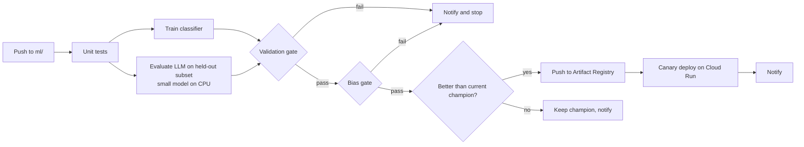
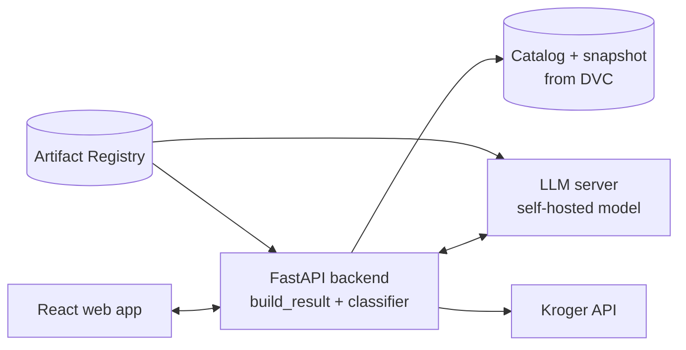

# Model Pipeline and Deployment Plan (initial)

**Status:** draft for team review. Owners, dates and targets are proposals until we agree on them.

This plan covers the model development milestone and how the models are deployed. It builds on what the data pipeline already provides (see [`docs/data-pipeline-report.md`](data-pipeline-report.md)):

- `build_result()` and the `result.json` v1.0 contract
- the 100-dish catalog and the allergen snapshot, versioned with DVC
- the shared diet rules in `shared/pantrypath_core`, which decide safety

---

## 1. What the models do

The data pipeline decides whether a product is safe. The models handle language, plus one extra safety check.

| Model | Task | Input → output |
|---|---|---|
| **A. Self-hosted LLM** | **A1. Understand the request** | Chat messages → `build_result()` arguments: dish, ZIP, allergens (fixed list), diet, plus servings and tweaks such as "crustless" |
| | **A2. Dishes outside the catalog** | Dish name → core ingredients in the catalog's format (replaces the API call the request flow needs today) |
| | **A3. Grounded answer** | `result.json` → shopping list, store summary, and swaps for `without_safe_product` items; every claim must exist in `result.json` |
| **B. Risk classifier** (trained) | Second opinion on safety | Ingredient text (+ category) → allergen and diet risk. A high-risk prediction **downgrades** a "safe" verdict to "unknown, flagged". It never upgrades anything to safe |

**Safety rule:** the diet rules decide; the LLM never marks a product safe, and the classifier can only make results more cautious.

---

## 2. Which LLM

Shortlist (all permissive licenses):

| Tier | Candidates | Role |
|---|---|---|
| Small (~4B) | Qwen3-4B, Gemma 4 E4B, Phi-4-mini | Development, CI evaluations, CPU serving if good enough |
| Mid (8-9B) | Qwen3-8B, Qwen3.5-9B | Production if the small models miss the targets |

**Starting point:** Qwen3-4B for development and CI; Qwen3-8B as the likely production model. The evaluation decides: **the smallest model that passes every gate wins.** Fine-tuning (LoRA) only if prompting with structured output falls short.

---

## 3. Model pipeline (mapped to the guidelines)

| Guideline item | Model A (LLM) | Model B (classifier) |
|---|---|---|
| Load data from the pipeline | `dvc pull`: catalog, snapshot, golden set → evaluation sets | `dvc pull`: `off_products.parquet`; labels from Open Food Facts allergen tags |
| Train and select the best model | Candidates × prompt variants × quantization, scored on the dev set; LoRA only if needed (the catalog's 254 refined dishes can serve as labels for A2) | TF-IDF + logistic regression, LightGBM, small transformer |
| Validation on held-out data | Valid JSON rate; A1 allergen-set F1 and dish match; A2 ingredient F1 vs the catalog; A3 groundedness (unsupported claims); latency | Per-allergen recall, false-safe rate, precision, F1, AUC, on products whose tags are hidden; split grouped by brand |
| Hyperparameter tuning | Temperature, few-shot count, quantization level; LoRA rank and learning rate if used | Grid or Optuna search; search space documented |
| Experiment tracking | MLflow: settings, metrics and model version per run; comparison charts | Same |
| Sensitivity analysis | Paraphrases, typos, allergy mentioned late; temperature and quantization curves | SHAP on ingredient tokens; hyperparameter sensitivity |
| Bias detection (Fairlearn) | Slices: cuisine, diet, allergen, catalog vs unseen dish, phrasing style | Slices: category, brand type, popularity (same as the data pipeline) |
| Bias mitigation | Few-shot examples or training data for weak slices | Re-weighting, per-slice threshold review |
| Model selection after bias checks | Best score among models that pass both the validation and bias gates | Same |
| Registry | Model artifacts and server images in GCP Artifact Registry | Same |

### Evaluation sets (held out)

- **Requests:** templated and paraphrased requests for each catalog dish and diet profile, reviewed by the team
- **Unseen dishes:** about 20 dishes not in the catalog, with reviewed ingredient lists
- **Answers:** `result.json` files from real requests, with checks for unsupported claims
- **Splits:** dev (prompt and model selection) and test (gates and final results only). The test set is never used for tuning.

### Proposed targets

| Metric | Target |
|---|---|
| Valid structured output (A1, A2) | ≥ 99% |
| Allergens and diet captured correctly (A1) | 100% on the test set |
| Ingredient F1 on unseen dishes (A2) | ≥ 0.85 |
| Unsupported claims in answers (A3) | 0 |
| Unsafe products presented as safe | 0 |
| Time to first token | ≤ 2 s |
| Classifier allergen recall (B) | ≥ 0.98 |
| False-safe rate after classifier (B) | ≤ 0.2% (from 0.4%) |
| Largest gap between slices | Within a threshold we set after the baseline |

---

## 4. CI/CD

GitHub Actions workflow, triggered by pushes and pull requests that touch `ml/`:



- **Notifications:** email or Slack on failure, completion, and failed gates
- **Rollback:** the current champion stays registered; Cloud Run traffic can return to the previous revision in one step
- **Docker:** training, evaluation and serving all run in containers

---

## 5. Deployment



| Component | Where |
|---|---|
| Frontend | Firebase Hosting or Cloud Run |
| Backend (FastAPI, calls `build_result()`, includes the classifier) | Cloud Run, scales to zero |
| LLM server | Separate Cloud Run service: llama.cpp or Ollama on CPU if a 4B model meets the latency target; vLLM on a GPU that scales to zero if the 8B model is needed |
| Data | Catalog SQLite and allergen snapshot pulled from DVC into the backend image |
| Releases | Cloud Run traffic splitting for canaries; one-step rollback |

**Budget:** GPU serving is the main cost risk on our $50 credit. Benchmark CPU serving of the 4B model first; use GPU hours only for development bursts and the demo.

---

## 6. Repository layout

```
ml/
  README.md                 how to run training, evaluation, serving
  Dockerfile
  configs/                  candidates.yaml, eval.yaml, gates.yaml
  prompts/                  parse_request, dish_ingredients, answer (versioned)
  evalsets/                 dev and test sets (tracked with DVC)
  src/pantrypath_ml/
    data.py                 load pipeline outputs, build evaluation sets
    llm/                    model client, candidates, structured output
    classifier/             features, training, tuning
    evaluate/               metrics, groundedness checks, gates
    bias.py                 Fairlearn slicing and reports
    sensitivity.py          perturbation tests, SHAP
    registry.py             MLflow logging, Artifact Registry push
    rollback.py             champion comparison
  tests/
  reports/                  model comparison, bias, sensitivity charts
infra/model-server/         Cloud Run service configuration
.github/workflows/model-pipeline.yml
```

---

## 7. Work split (owners to be assigned)

| Workstream | Covers |
|---|---|
| LLM candidates and serving | Candidate setup, structured output, quantization, latency benchmark, model server |
| Evaluation sets and harness | Held-out sets, metrics, groundedness checks, gates |
| Risk classifier | Features, training, tuning, SHAP, integration with the diet rules |
| Bias and sensitivity | Fairlearn slicing, perturbation tests, mitigation, report sections |
| CI/CD and deployment | Workflow, Docker, Artifact Registry, Cloud Run, notifications, rollback |

---

## 8. Phases

| Phase | Done when |
|---|---|
| **1. Baseline** | Evaluation sets built and split; harness running; Qwen3-4B baseline and classifier baseline logged in MLflow |
| **2. Selection** | All candidates compared; tuning, bias slicing and sensitivity analysis done; best models chosen |
| **3. Automation and deployment** | CI/CD with gates, registry push, canary deploy, notifications and rollback working; report written |

---

## 9. Open decisions

1. Confirm tasks A1-A3 and adding the risk classifier
2. Confirm the shortlist, then the serving path after the latency benchmark
3. Agree on the targets and the slice-gap threshold
4. Assign workstream owners and set phase dates against the due date
