# Pantry Path: Model Pipeline Report

November 2026. This covers the model pipeline milestone: the models, how they were chosen and checked, and how the champion is released to Google Cloud.

## What we built

Pantry Path helps people with allergies and diets find groceries for a dish they want to cook. The data pipeline (see `docs/data-pipeline-report.md`) turns a request into `result.json`: the dish's ingredients and, for each one, store products marked safe, unsafe or unknown. This milestone adds the models around that file. One self-hosted model, **Qwen3-4B** at 4-bit, does three jobs:

- **A1, request parsing:** the shopper's chat becomes the request (dish, ZIP code, allergens to avoid, diet), plus extras such as servings and needs we can't check.
- **A2, unseen dishes:** a dish name the catalog doesn't know becomes a dish profile (its core and common ingredients).
- **A3, the answer:** `result.json` becomes what the shopper reads: a shopping list, steps and a summary.

The models never decide whether a product is safe. Only the diet rules from the data pipeline do that, and unknown is never shown as safe. A model that runs before `result.json` is still safety-critical, though: if A1 drops an allergen, every verdict is correct for the wrong question. That is why A1's allergen and diet capture are gated at 100%.

**In short:**
- The champion passed every hard gate and the A1 bias gate on the held-out sets: A1 captured 100% of allergens and diets; every A3 answer shown was clean; A2 gave a valid profile every time.
- A2 is short of its accuracy goals.
- On Cloud Run's CPUs, latency is far over target.

Qwen3-4B is the deliberate starting model (below). The pipeline around it doesn't depend on the model: a larger challenger, starting with Qwen3-8B, goes through the same evaluation, gates and champion comparison. The status of every guideline item is in the compliance table in [`ml/README.md`, Guideline compliance](../ml/README.md#guideline-compliance).

## Model choice

We chose Qwen3-4B deliberately as the starting model. It let us build and validate the whole pipeline (evaluation sets, gates, bias checks, tracking, registry, CI/CD, deployment and rollback) quickly on a laptop, with Ollama and no GPU. It also keeps the first deployment cheap: a CPU-only Cloud Run service that scales to zero and stays within the team's GCP credits. It is open-weight (Apache 2.0), so we self-host it and no shopper data leaves our project.

The pipeline is model-agnostic. A larger model is one entry in `ml/configs/candidates.yaml` (its size and its model id per server), and it goes through the same evaluation, gates, bias checks and champion comparison. The serving image takes the model id from the champion record. The selection rule prefers the smallest model that passes every gate, so a larger challenger is proposed explicitly (`select choose --runs` with its runs). It then becomes the champion only if the final confirms it and it is no worse than the current champion on every goal and better on the score.

**The first planned challenger is Qwen3-8B, for A2,** the weakest task. On the golden dev set (run `20261113T035101Z-a2-826af2`) it reached 73.4% recall and 73.9% core precision, against the 4B's 65.3% and 65.1%, with every profile valid. That's still below the 75% and 85% goals. It is also 70% slower on the laptop (20.8 s against 12.3 s per dish) and needs about twice the memory, so it waits for a GPU. The **GPU deployment for the Expo** is a proposal; its region, quota and cost are still to confirm (see Latency).

## Adapting the guidelines to a pre-trained generative model

The guidelines' closing note says that with pre-trained large models some steps, such as training and hyperparameter tuning, may not be necessary, but validation, bias detection and tracking still are. We applied it this way:

- **Evaluation instead of training.** We train no weights. "Selecting the best model" means choosing the prompt, temperature, thinking mode and quantization of a pre-trained model by their measured results. In CI, the training step becomes an evaluation of the proposed setting on a dev sample, followed by the same gates.
- **Tuning as a search over settings.** The "hyperparameters" are the prompt variant, temperature, thinking and quantization, searched in stages (Model selection and search).
- **Perturbation tests instead of SHAP or LIME.** A generated JSON reply has no fixed input features to attribute. So we measure how the outputs change when the chat is paraphrased, misspelled or reordered, or when an allergy is mentioned late (Sensitivity).
- **Validation, bias detection and tracking are done in full:** held-out sets, Fairlearn slices with a blocking gate, and every run in MLflow.

## Data and splits

All the data comes from the data pipeline's outputs, pulled from its public DVC remote with no credentials: the 100-dish catalog (`dish_profiles.json`, `pantrypath.sqlite`) and the golden recipes. The model code imports the pipeline's functions instead of copying them: `find_dish` to resolve dishes, `refine_dish` and `build_profile` for A2, its ingredient matcher to score A2, and the `result.json` contract and diet rules for A3. So what we evaluate is what the request flow runs. No Kroger data is stored anywhere, including in the evaluation sets.

| Set | Size | Use |
|---|---|---|
| A1 generated, dev | 420 chats | Tuning |
| A1 generated, test | 180 chats | Gates and final results only |
| A1 realistic dev | 34 chats | Tuning (everyday phrasing) |
| A1 realistic | 45 hand-written chats (41 count) | Final only |
| A2 golden dev | 16 recipes | Tuning |
| A2 golden test | 27 recipes | Final only |
| A2 leave-one-out | 73 catalog dishes (the test dishes left out) | Selection and the selection bias check |
| A2 leave-one-out, full | all 100 dishes | Final A2 bias check only |
| A3 dev / test | 70 / 30 synthetic `result.json` files | Tuning / final only |

The A1 sets are generated from catalog dish names and a phrase bank (negations, typos, synonyms, late mentions, multi-turn corrections) and split by dish, so a test dish never appears in tuning. They share wording with A1's cross-check word lists, which is why the hand-written realistic set exists. Four realistic chats are left out of its metrics because they paraphrase examples the cross-check was fixed on. The A3 sets have one synthetic `result.json` per catalog dish, with synthetic stores and products, about 20% unknown verdicts, and the same test dishes as A1.

The held-out splits are read only when asked for by name. Each read is logged and tagged in MLflow, and CI never reads them.

## Model selection and search

Selection works in two steps (`ml/src/pantrypath_ml/select.py`). First, every setting must pass the hard gates: A1 allergens and diet captured 100%, unsupported needs flagged 100%, valid JSON at least 99%; A2 valid profile at least 99%; A3 shown answer clean 100%, valid JSON at least 95%, repaired at most 50%; and the A1 bias gate. Then the smallest model wins, followed by the best weighted score. A new setting replaces the champion only if it is no worse on every goal and better on the score.

We ran a staged local search on the development laptop with Ollama (`configs/search.yaml`): prompt variants first, then temperature 0.2, then the leave-one-out run, with thinking as an opt-in. All of it ran at 4-bit. The wider Explorer grid (8-bit, more temperatures) is ready in `ml/slurm/` but was not run.

| Task | Setting | Result on dev | Kept? |
|---|---|---|---|
| A1 | `base` prompt | allergen exact match 70.0% | No |
| A1 | `rules_v2` prompt, temperature 0 | allergen exact match 89.3%, 2.5 s per chat | **Yes** |
| A1 | `rules_v2`, temperature 0.2 | 89.1%, 2.8 s | No: no better, slower |
| A1 | `rules_v2`, thinking on (60 chats) | 100%, but 20.7 s per chat against a 3 s limit | No |
| A2 | `refine_dish` (the pipeline's prompt) | recall 51.6%, core precision 63.5% | No |
| A2 | `refine_dish_unknown`, temperature 0 | recall 65.3%, core precision 65.1%, 12.3 s per dish | **Yes** |
| A2 | `refine_dish_unknown`, temperature 0.2 | recall 62.9%, core precision 65.2% | No |
| A2 | `refine_dish_unknown`, thinking on | valid profiles 93.75% (gate 99%), 135 s per dish | No: failed a gate |
| A3 | `answer/1`, the model writes the whole list | repaired 92.9% (gate 50%) | No: failed a gate |
| A3 | `hybrid_swaps` (`answer/3`) | repaired 14.3%, verdict safety 100% | **Yes** |

**A note on numbers.** This report uses the rescored values throughout. A2 runs were rescored after the November 12 matcher change (six synonym pairs), and A3 runs after grounding-check changes, both from saved replies with no model calls. MLflow still shows the values logged at run time, so some of its numbers are pre-rescore: 63.7% A2 recall for `refine_dish_unknown`, for example.

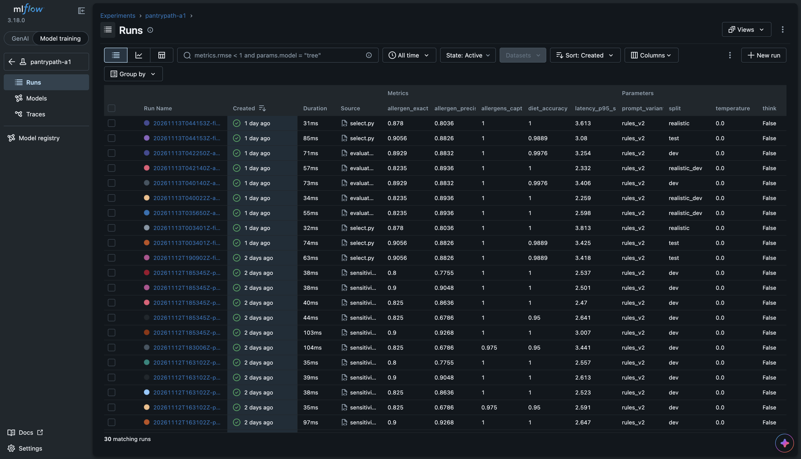

*Figure 1. The A1 experiment in MLflow: 30 runs, with the split, prompt variant, temperature and thinking of each, and the metrics they logged.*

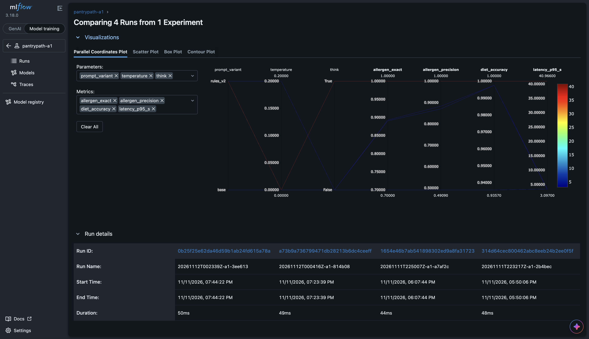

*Figure 2. Four A1 settings compared: `base` against `rules_v2`, temperature 0 against 0.2, and thinking on. Thinking raises latency (p95) about eightfold.*

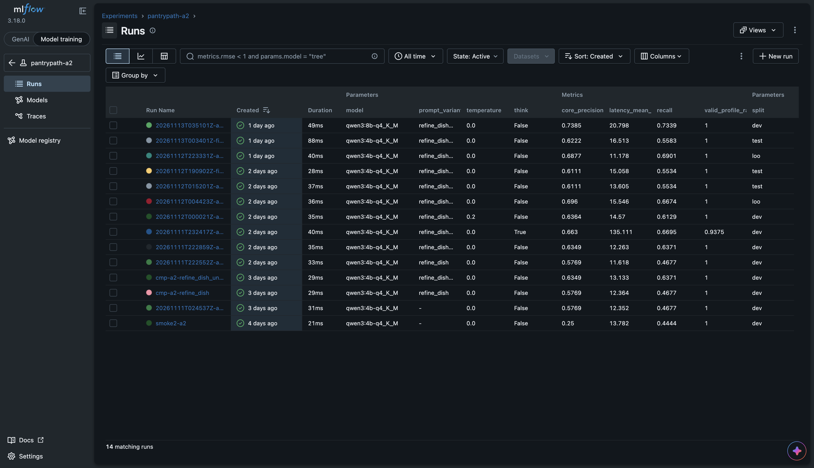

*Figure 3. The A2 experiment, including the Qwen3-8B run (top row) and the thinking-on run that failed the valid-profile gate.*

### The champion

| | Prompt | Temperature | Thinking |
|---|---|---|---|
| A1 | `rules_v2` (`parse_request/1+rules_v2`) | 0 | off |
| A2 | `refine_dish_unknown/1` | 0 | off |
| A3 | `hybrid_swaps` (`answer/3`) | 0 | off |

Model: `qwen3:4b-q4_K_M` on Ollama 0.40.15 (`ml/registry/champion.json`).

### The A3 redesign

The first A3 (`answer/1`) let the model write the whole shopping list. On the 70 dev results, 92.9% of its answers needed the repair step. Only 7.1% broke no rule, and its substitutes were safe only 48.6% of the time (whole wheat tortillas for someone avoiding wheat, for example). The gates blocked it: at most half the answers may need the repair.

So the list moved to code. In the hybrid (`answer/2`), code decides each ingredient's status, product and store from `result.json`, and picks substitutes from the substitution table (`ml/configs/substitutes.yaml`), each one screened against the shopper's allergens and diet. The model only writes the summary, steps and quantities around that fixed list. `hybrid_swaps` (`answer/3`) adds an explicit "use X instead of Y" list. A deterministic check then holds every answer to `result.json`. Anything still broken after one retry is repaired, so the answer shown always passes.

| A3 version | Repaired (dev) | Repaired (test) | Text safety (test) | Gates |
|---|---|---|---|---|
| `answer/1`, model writes the list | 92.9% | not run | | Blocked |
| `answer/2`, hybrid | 20.0% | 33.3% | 66.7% | Passed |
| `answer/3`, hybrid with swaps | 14.3% | **10.0%** | **90.0%** | Passed, champion |

`answer/3` was written after `answer/2`'s test result, so its 10.0% is not a clean held-out number (see Held-out validation).

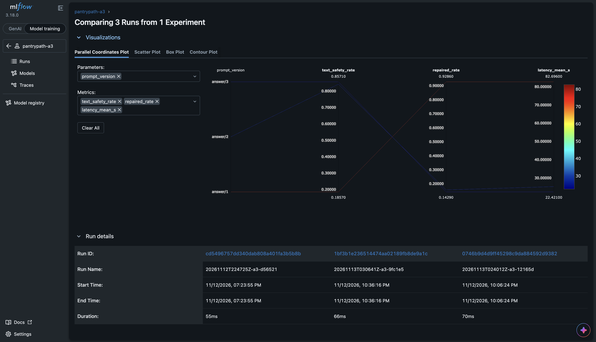

*Figure 4. The three A3 prompt versions on dev. `answer/1` needed the repair in most answers; the hybrids rarely did.*

The substitution table was **drafted for this project, audited automatically against Open Food Facts (`audit_substitutes`), and not yet reviewed by a person** (see Limitations).

## Held-out validation

The champion was confirmed once more on the held-out sets with `select final`. The committed report is `ml/reports/final/20261113T233257Z-final/` (gates applied at commit `7208394`; the model runs are those of final `20261113T044153Z-final`, with the same setting). It passed every hard gate and the A1 bias gate.

| | Metric | Result | Target | |
|---|---|---|---|---|
| A1 test (180) | Allergens captured | 100% | 100% | Gate |
| | Diet captured | 100% | 100% | Gate |
| | Unsupported needs flagged | 100% | 100% | Gate |
| | Valid JSON | 100% | ≥ 99% | Gate |
| | Dish resolution | 98.9% | ≥ 95% | Goal, met |
| | Allergen set exact match | 90.6% | | Reported |
| | Diet accuracy, ZIP accuracy | 98.9%, 100% | | Reported |
| A1 realistic (41) | Allergens and diet captured | 100% | 100% | Gate |
| | Valid JSON | 100% | ≥ 97% | Gate |
| A2 test (27) | Valid profile | 100% | ≥ 99% | Gate |
| | Ingredient recall | 55.8% | ≥ 75% | Goal, **not met** |
| | Core precision | 62.2% | ≥ 85% | Goal, **not met** |
| A3 test (30) | Shown answer clean | 100% | 100% | Gate |
| | Valid JSON | 100% | ≥ 95% | Gate |
| | Repaired | 10.0% | ≤ 50% | Gate |
| | Verdict, substitute safety | 100%, 100% | ≥ 95%, ≥ 90% | Goals, met |
| | Text safety, coverage, missing handled | 90.0%, 100%, 91.8% | ≥ 90% each | Goals, met |

A1's 100% capture rests on two layers: the model's own allergen recall per allergen is 94.4% to 100%, and the deterministic cross-check catches the rest. When the model misses an allergen the chat mentions, the request goes back to the shopper for confirmation, with a stricter suggestion.

**How clean these results are.** Each test set was read more than once during development:

| Held-out set | Reads | What changed between reads |
|---|---|---|
| A1 test | 4 | Nothing: same setting, same results (90.6% exact match each time) |
| A2 test | 3 | Nothing: same setting; recall 55.3% → 55.8% after the matcher rescore |
| A1 realistic | 2 | Nothing: same setting, same results |
| A3 test | 2 | **The prompt.** `answer/3` was written after `answer/2`'s test result (33.3% repaired) |

The A1 and A2 repeats used the same setting, so they leaked nothing new. A3's did not: the prompt was improved after its first test result, so the final 10.0% repaired is not a clean held-out result. A fresh A3 test set would confirm it.

**The cleanest held-out evidence is the realistic set:** 41 hand-written chats, written apart from the cross-check's word lists, never tuned on and read only by the two finals, both with the same setting. It shows 100% allergens and diet captured and 100% valid JSON. It also shows the cost of the cautious design: 22.0% of the chats got a confirmation question they didn't need, and 6 of 41 (85.4%) didn't resolve to the intended catalog dish. Those cost the shopper a step, not their safety.

## Bias

The guidelines ask for slices, metrics per slice, the gaps found, mitigation and its trade-offs.

### Why these slices

The data has no demographic attributes. A chat carries no age, gender, ethnicity or location beyond a ZIP code, and we collect nothing about the shopper by design. So we slice by the groups this product actually serves, and by the differences between shoppers that show up in what they type:

- **Diet and allergy groups** are the product's users. Someone avoiding sesame, a vegan, or someone with celiac disease relies on the model to carry their needs into `result.json`. If A1 works worse for one allergen or one diet, that whole group gets less safe results, so A1 is sliced by each of the 10 allergens and the 3 diets, and the gate is on allergens captured.
- **Phrasing styles stand in for the differences we can't observe.** People write differently depending on language background, age, literacy, and whether they type on a phone. Non-native speakers paraphrase or use synonyms ("dairy" for milk); fast typists make typos; some people mention the allergy late or correct themselves over several messages. Our 7 styles (casual, formal, late mention, multi-turn, negation, synonym, typo) test whether the model serves all of them equally. They are a proxy, not a measurement of any demographic group.
- **Cuisines are cultural groups.** Shoppers often cook the food of their own culture. If A2 profiles European or South Asian dishes worse than American ones, the people who cook those dishes get worse shopping lists. That is the same concern behind the data pipeline's cuisine quotas. **Popularity tiers** add the long tail: less common dishes, which are often from the smaller cuisines.

**How.** `ml/src/pantrypath_ml/bias.py` slices the per-case results of every evaluation with Fairlearn's `MetricFrame` and writes a Markdown report and a bar chart per metric and slice. Groups under 10 items are shown but not counted in the gap. The gate (`ml/configs/gates.yaml`, `bias`) uses the largest gap of the main metric: at most 10 points, blocking for A1 and a reported warning for A2.

### Slices and metrics per slice

| Model | Slices | Main metric (gated) | Also reported |
|---|---|---|---|
| A1 | phrasing style (7), diet (3), allergen (10) | allergens captured | allergen exact match, model's own allergen recall |
| A2 | cuisine (6), popularity tier (3) | ingredient recall | core precision, valid profile |

**A1 on the test set (180 chats).** The gated metric, allergens captured, is 100% in every style, diet and allergen group: a gap of 0.0 points. The model's own exact match varies more:

| A1 test, by style | casual | formal | late | multi-turn | negation | synonym | typo |
|---|---|---|---|---|---|---|---|
| Allergen exact match | 92.3% | 88.9% | 88.9% | 91.3% | 95.7% | **77.8%** | 100% |

The 22-point gap (synonyms against typos) is in exact match, not in capture. The cross-check absorbs it: a missed "dairy" still ends up as milk, or the shopper is asked. By diet, exact match is 93.2% (none), 88.1% (vegetarian) and 85.7% (vegan). By allergen, the model's own recall is 94.4% (fish) to 100%.

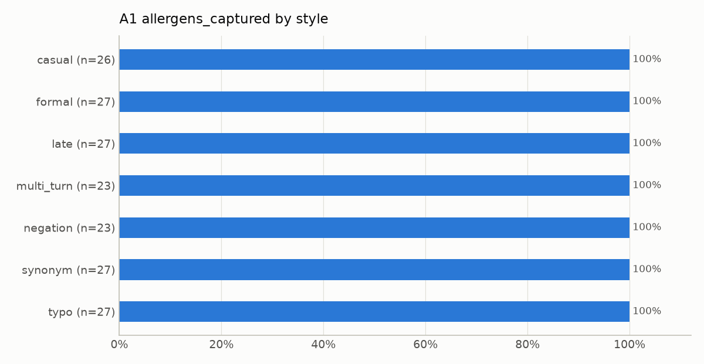

*Figure 5. A1 allergens captured by phrasing style on the test set: 100% in all seven styles.*

**A2 on the full leave-one-out run (100 dishes).**

| A2, by cuisine | American (60) | East/SE Asian (10) | European (10) | Latin American (10) | Middle Eastern/African (5) | South Asian (5) |
|---|---|---|---|---|---|---|
| Recall | 68.9% | 70.6% | **57.1%** | 63.2% | 76.0%* | 65.2%* |
| Core precision | 73.9% | 67.4% | 75.0% | **62.2%** | 46.2%* | 65.0%* |

\* Fewer than 10 dishes: shown, not counted in the gap.

The recall gap is 13.5 points (European against East and Southeast Asian), over the 10-point limit. The core precision gap is 12.8 points. By popularity, recall is 70.6% (high), 68.1% (mid) and 64.0% (low). For A2 this is a warning, not a gate. The cuisine groups are small, and the references are catalog entries written by an LLM rather than ground truth, so the gap is a consistency signal, not a measured error rate. It is still a gap, and we treat it as one.

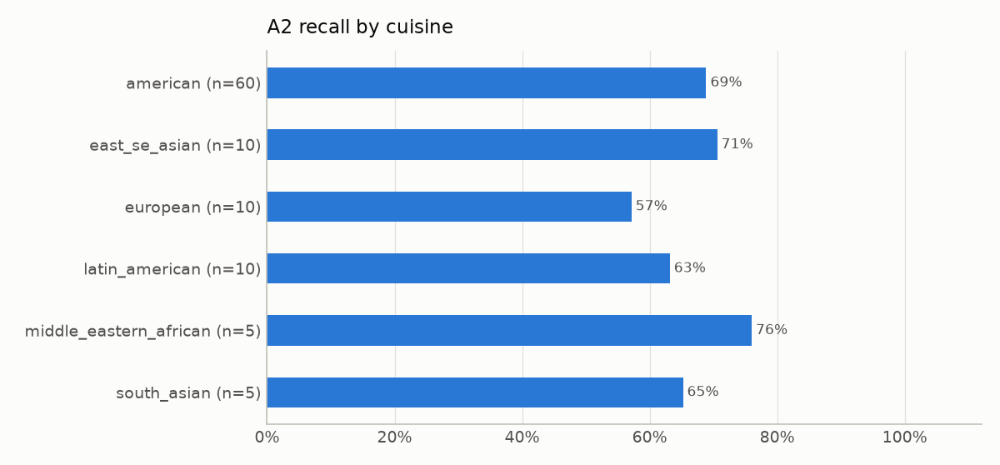

*Figure 6. A2 ingredient recall by cuisine on the full leave-one-out run. European dishes are lowest.*

### Mitigation

**A1, applied.** The weakest slice under the `base` prompt was multi-turn chats, where the shopper corrects themselves ("actually, tree nuts are fine"). The `rules_v2` prompt adds retraction rules: read every message, a later message overrides an earlier one, and leave out an allergen the shopper says they can eat ("I can eat X", "X is fine"). It also adds examples. The cross-check was widened to match: foods made from an allergen, "lactose intolerant", "nothing with", lists in parentheses, and a narrower "is fine" that clears only the allergen it names. Results on the 420 dev chats:

| A1 dev | `base` | `rules_v2` |
|---|---|---|
| Exact match, multi-turn slice (62 chats) | 40.3% | **72.6%** |
| Exact match, all chats | 70.0% | 89.3% |
| Chats with an extra allergen | 29.8% | 9.0% |
| Chats sent back for confirmation | 23.6% | 9.0% |
| Diet accuracy | 93.6% | 99.8% |
| Dish resolution | 99.3% | 98.6% |

Every other style also rose, to 88% to 94%. One example from the perturbation runs: "nothing with milk, tree nuts and peanuts … actually tree nuts are fine". The model's reply dropped peanuts too. Before the narrower "is fine" rule the cross-check let that pass; after it, the request goes back with peanuts in the suggestion.

**A2, identified, not applied.** The plan:
- Add targeted few-shot examples and rules for European dishes, the weakest cuisine.
- Rerun the full leave-one-out check, and accept the change only if the gap closes without lowering any other cuisine.
- Then try Qwen3-8B, which is 8 points better overall on dev.

Re-weighting or re-sampling don't apply, because nothing is trained. The lever is the prompt (or the model).

**Trade-offs.**
- `rules_v2` costs 0.7 points of dish resolution on dev.
- Multi-turn chats remain the weakest A1 style (72.6% against 88% or more for the others).
- The cross-check is deliberately cautious, which costs friction: on the realistic set, 22.0% of chats got a confirmation question they didn't need. We accept that, because asking is safe and missing an allergen isn't.
- For A2, keeping the gap a warning rather than a gate means a setting with a cuisine gap can still be chosen. The gap is recorded in every selection and final report with its reason.

### Selection after bias checks, and in CI

`select choose` drops any setting that fails a hard gate or the A1 bias gate, and `select final` applies both again on the held-out sets. There, an A1 gap that can't be measured fails instead of passing silently. CI also runs the bias check on its dev sample, but the sample is too small for any slice to reach 10 items: every CI run reports "bias gap not measurable (insufficient data)" as a warning. The blocking bias gate therefore applies in `select final`, and promotion requires a committed passing final report.

## Experiment tracking

Every evaluation logs an MLflow run (MLflow 3.18) with the same tags: task, candidate, model, quantization, prompt version, split, run id and git commit. Each run also stores its settings, its metrics and its report folder as artifacts. The store has 53 runs: 30 for A1, 15 for A2 and 8 for A3. MLflow is used for tracking only; the registry is Artifact Registry (below).

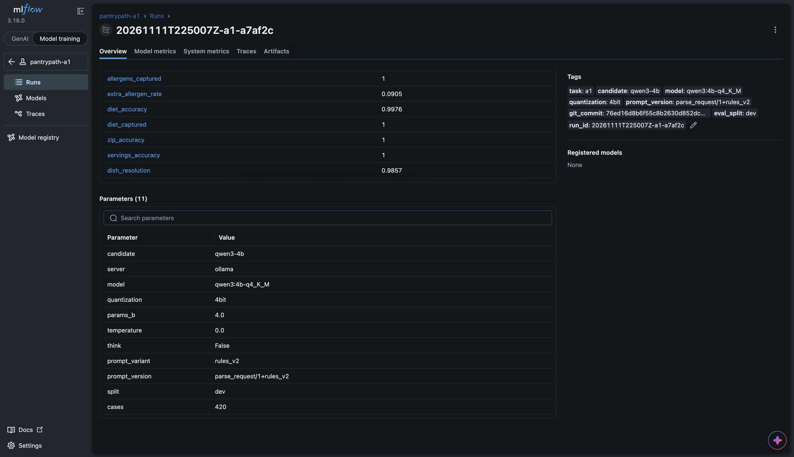

*Figure 7. The champion's A1 dev run: its parameters, metrics and tags, including the git commit and split.*

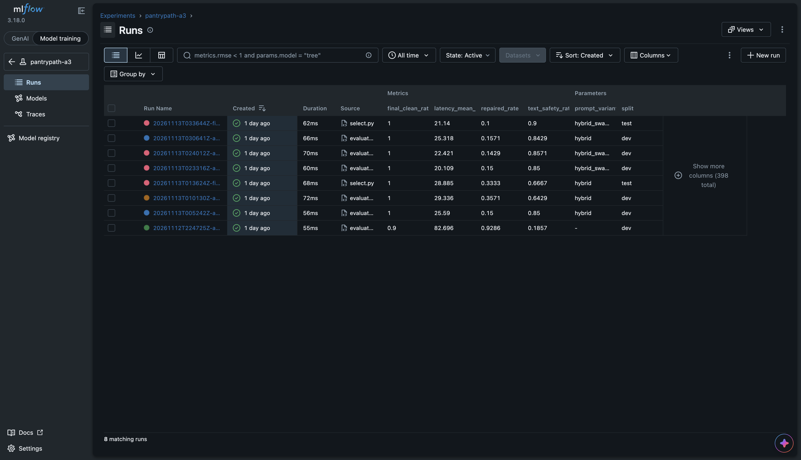

*Figure 8. The A3 experiment: dev and test runs of each prompt version.*

The store is a local SQLite file on the development laptop (`ml/mlruns/`, not committed). Teammates see the runs as a zipped copy or through `MLFLOW_TRACKING_URI` pointed at a shared server, which we haven't set up. The per-run report folders under `ml/reports/` are also local, except the committed final report.

## Sensitivity

**Hyperparameter sensitivity** (from the search runs, dev sets):

| Change | A1 effect | A2 effect |
|---|---|---|
| Prompt variant | +19.3 points exact match (`base` → `rules_v2`) | +13.7 points recall (`refine_dish` → `refine_dish_unknown`) |
| Temperature 0 → 0.2 | −0.2 points exact match, +0.25 s | −2.4 points recall |
| Thinking on | exact match 100% on 60 chats, but 8 times slower (20.7 s) | 11 times slower (135 s), valid profiles 93.75%, below the gate |
| Quantization | not varied (4-bit only) | not varied |

The prompt matters most, temperature hardly at all, and thinking trades a large latency cost for little gain.

**Input sensitivity, in place of feature importance.** SHAP and LIME attribute a prediction to fixed input features, which a generated JSON reply doesn't have. So we perturb the input instead (`python -m pantrypath_ml.sensitivity perturb`, 40 A1 dev chats, latest run `20261112T185345Z-perturb`). Each chat is rewritten four ways and scored against the original:

| Perturbation | Allergens captured | Exact match | Diet accuracy | Dish resolution |
|---|---|---|---|---|
| Original | 100% | 90.0% | 100% | 100% |
| Paraphrase | 100% | 82.5% (−7.5) | 95.0% (−5.0) | 100% |
| Typo | 100% | 82.5% (−7.5) | 100% | 92.5% (−7.5) |
| Allergy mentioned late | 100% | 90.0% | 100% | 100% |
| Sentences reordered | 100% | 80.0% (−10.0) | 100% | 100% |

The safety metric doesn't move under any perturbation. Exact match drops by up to 10 points. Of the 18 cases that lose a metric, 13 end in `needs_confirmation` (the shopper is asked, not misled); the other 5 are a missed dish lookup or an extra allergen, both cautious. Typos cost dish resolution: a misspelled "banana bread" misses the catalog.

## CI/CD with gates

`.github/workflows/model-pipeline.yml` runs on pushes to `main`, `model-pipeline` and `feature/**`, and on pull requests into `main` and `model-pipeline`, whenever `ml/`, `shared/`, the data pipeline's code, prompts or config, or `data/golden/` change. It can also be started by hand. The jobs:

1. **test:** 274 unit tests and ruff. No network or model is needed.
2. **evaluate**, the CI equivalent of training for a pre-trained model:
   - It starts Ollama on the runner's CPU and runs the proposed setting on a seeded **dev** sample: 14 A1 chats, 4 A2 dishes and 3 A3 results.
   - It applies the hard gates and the bias check, and the job fails on a breach.
   - It compares the proposal with the champion using the newest committed final report. A CI result is never promoted.
3. **release:** described under Deployment and rollback.
4. **notify:** builds an alert on failure, failed gates and completion.

**The gate blocks a worse model.** Pull request #10 proposed the old A3 prompt (`answer/1`) on purpose. Both its runs (push 43642889158 and pull request 43642892979) failed the `evaluate` job. On the CI sample, 100% of A3 answers needed the repair against a 50% limit, and substitute and text safety were 33.3% against 90% goals. Release was skipped, and the pull request was closed without merging.

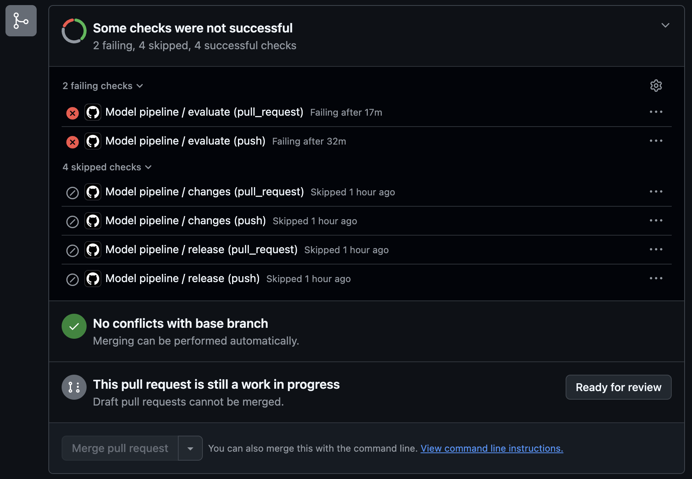

*Figure 9. Pull request #10: both `evaluate` checks fail, so `release` is skipped.*

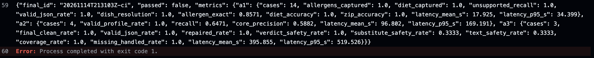

*Figure 10. The CI evaluation summary for pull request #10 (push run): `"passed": false`, with A3 `repaired_rate` 1.0.*

**Alerts.** The notify job runs after every run, successful or not, and reports one of three outcomes:
- a failed gate, as a warning, with the gate table;
- any other failure, as an error;
- completion, as information, saying whether the champion was promoted.

All three have been produced:
- run 43642892979: "ALERT WARNING: model gates failed on 10/merge";
- run 43634131023: "ALERT ERROR: model pipeline failed on model-pipeline";
- run 43639727114: "ALERT INFO: model pipeline completed on model-pipeline (promoted: false)".

None was delivered: the email and Slack secrets (`ALERT_EMAIL_TO`, `ALERT_SMTP_USER`, `ALERT_SMTP_PASSWORD`, `SLACK_WEBHOOK_URL`) aren't set in the repository, so every run so far logged `emailed: False, slack: False`. The data pipeline's email path, which the notify job reuses, was tested on 2026-10-26. The model pipeline's own delivery is untested until the secrets are added.

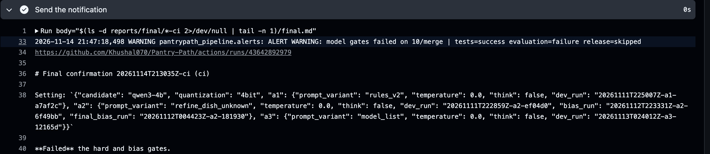

*Figure 11. The notify job of run 43642892979 builds the gate-failure alert.*

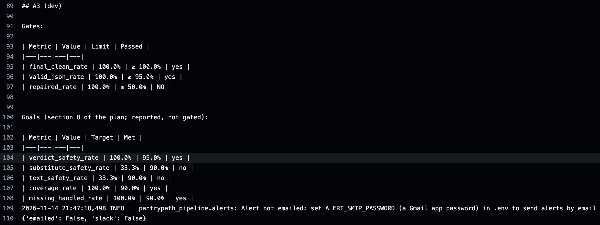

*Figure 12. The same alert's A3 gate table, and the line saying it was not emailed because the SMTP secret isn't set.*

## Registry

Two Artifact Registry repositories in `us-east1` hold the releases:

- **`pantrypath-images`** (Docker): the model-server image, tagged with the git commit. The image is Ollama 0.40.15 with the champion's weights baked in. It is a slim CPU build: the official image's GPU libraries are left out, which brought the pushed image from about 5.9 GB to 2.6 GB. A cleanup policy keeps the 5 newest versions and deletes anything older than 14 days.
- **`pantrypath-models`** (generic): the champion record (`registry/champion.json`), one version per promotion. Rollback restores the previous version from here. The current champion is version `20261114t201912`.

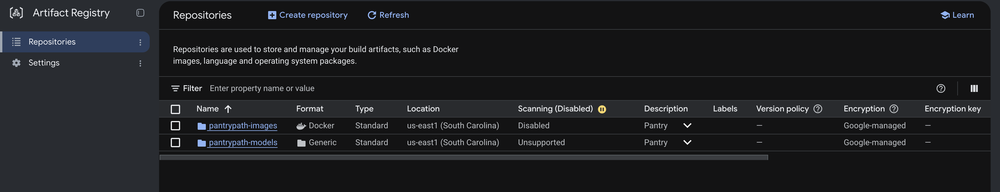

*Figure 13. The two repositories.*

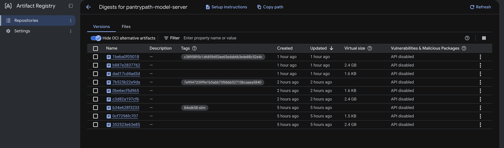

*Figure 14. Model-server image versions: the manual build `84ed658-slim` and the CI builds tagged with their commits (`7e99473…`, `c389589…`).*

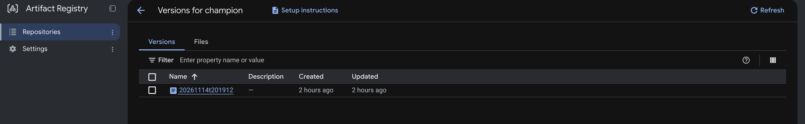

*Figure 15. The champion record package, version `20261114t201912`.*

## Deployment and rollback

The model server runs on **Cloud Run**: service `pantrypath-model-server`, `us-east1`, private (callers need a Google identity token), 4 vCPU, 8 GiB, one request at a time per instance, a 600 s request timeout, and 0 to 2 instances. It scales to zero, so it costs nothing while idle, and the first request after idle includes a cold start. The backend calls it through `pantrypath_ml.runtime`.

**Release.** The `release` job runs on a push to `main` or `model-pipeline` whose commit changed `ml/registry/champion.json`, anything under `ml/serving/` or the workflow itself. It never runs for pull requests or manual runs. It pulls the catalog, builds and pushes the image, pushes the champion record (only when it changed), deploys a new revision and smoke-tests it (`latency_check.py --smoke`: every reply must be valid; latency is reported but not gated). One release runs at a time.

The model it deploys is always the committed champion, and `select promote` only writes `champion.json` from a committed final report that passed the hard and bias gates. So a model reaches the registry and Cloud Run only after validation and bias checks. A worse model is never promoted: the champion comparison refuses it.

**Release run 43639727114** (merge of #9) passed end to end. The release job took 12 minutes: image push 3 min, deploy 55 s, smoke test 6 min. Revision `00003-nrh` now serves 100% of traffic.

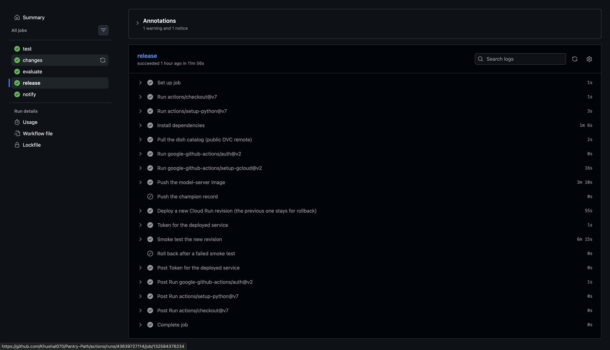

*Figure 16. Release run 43639727114: every step passes. The champion push is skipped (the champion didn't change), and so is the rollback.*

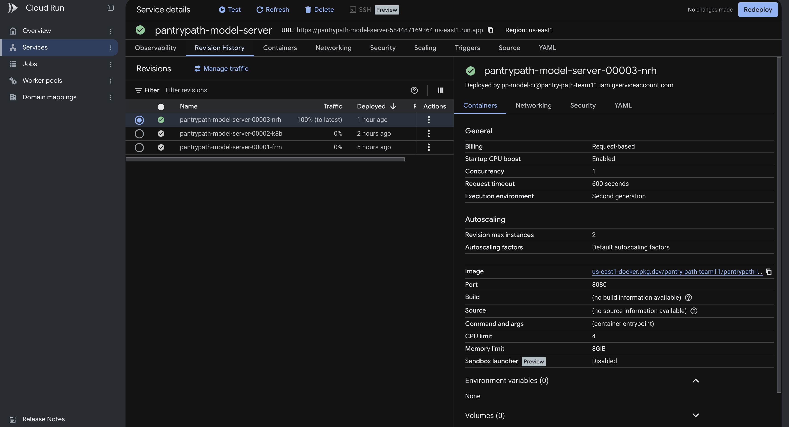

*Figure 17. Cloud Run: `00003-nrh` serves 100%. `00002-k8b` (the failed release) and `00001-frm` (the first manual deploy) are kept for rollback.*

**Automatic rollback, run 43634131023.** The first CI release deployed `00002-k8b`, and its smoke test failed. The release job hadn't pulled the dish catalog, so A1's dish lookup raised `DataUnavailableError`. The rollback step moved all traffic back to `00001-frm` in 16 seconds, as designed. The step still exited with an error afterwards: it then tried to restore the previous champion record, and the record package didn't exist yet. Pull request #9 fixed all three issues: the release now pulls the catalog; the record is restored only when the failed release pushed a new one (`RESTORE_CHAMPION`, with tests); and the current champion was uploaded. The next release (run 43639727114) passed.

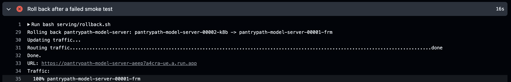

*Figure 18. Run 43634131023: the rollback moves traffic from `00002-k8b` back to `00001-frm`.*

A rollback can also be run by hand: `bash ml/serving/rollback.sh`, or `REVISION=<name>` for a specific revision.

### Latency

CPU latency is far over target. The `gates.yaml` targets are 3 s per A1 request and 15 s per A2 dish on the deployed server. A3 has no target.

| Where | A1 mean | A2 mean | A3 mean |
|---|---|---|---|
| Development laptop, Ollama native (final test runs) | 2.5 s | 16.5 s | 21.1 s |
| Docker on the laptop, `--cpus 4 --memory 8g` (dev, 10/3/3 items) | 24.9 s | 124.7 s | 166.9 s |
| **Cloud Run, 4 vCPU** (`latency_check.py`, dev, 10/3/3 items) | **20.8 s** | **114.9 s** | **112.7 s** |
| Cloud Run, CI smoke test of run 43639727114 (3/1/1 items) | 34.2 s | 150.6 s | 107.1 s |

The laptop numbers use its GPU through Ollama, while the container and Cloud Run use CPU only. A 4B model on 4 vCPU is roughly 8 times too slow for A1. The slowest reply measured on Cloud Run, about 205 s (one A3 answer in a smoke test), is well inside the 600 s timeout, so the service is usable for testing, not for shoppers. That was the expected price of the cheap first deployment.

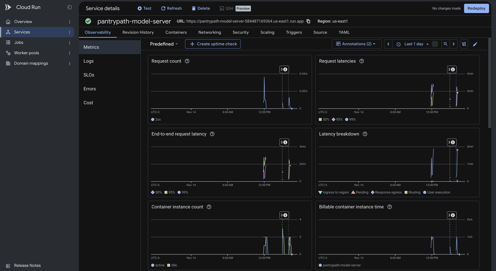

*Figure 19. Cloud Run metrics during the latency checks: request latencies of up to about 3 minutes, and instances scaling up from zero during the checks and back to zero when idle.*

**GPU deployment for the Expo (a proposal; region, quota and cost still to confirm).** Serve the same image on a Cloud Run GPU (an NVIDIA L4), and keep the CPU service for development. The README already lists this as the option to take after measuring. Steps:

1. Confirm L4 availability in our region (or move the GPU service to a region that has it), request GPU quota, and price it against the team's credits.
2. Deploy the same image as a second service with one GPU. A GPU service needs instance-based billing and at least 4 vCPU and 16 GiB.
3. Run `latency_check.py` against it and record the numbers here.
4. Keep min-instances at 0, except during the Expo itself, when one warm instance avoids cold starts. Set it back to 0 afterwards.
5. With a GPU, evaluate Qwen3-8B, the first challenger, through the same gates and champion comparison.

## Running it in Docker

Both halves of the pipeline are containerized:
- **The evaluation runner** (`ml/Dockerfile`, built from the repo root) holds every harness with pinned dependencies, the data pipeline's code and the golden data. It runs any step against a model server on the host. It builds locally in about two and a half minutes (420 MB compressed; checked on 2026-11-14), and `ml/Dockerfile.dockerignore` keeps local environments, caches and reports out of it.
- **The model server** (`ml/serving/Dockerfile`) is the image the registry holds and Cloud Run serves.

## Limitations

- **The model is a starting point, chosen for speed and cost.** Qwen3-4B on CPU was the quickest way to build and validate the whole pipeline and the cheapest way to deploy it. The accuracy and latency below come from that choice. The fix runs through the same pipeline: Qwen3-8B as a challenger, on a GPU.
- **The test sets were evaluated more than once during development.** A1 test 4 times, A2 test 3 times, A1 realistic and A3 test twice each. The A1 and A2 repeats used the same setting and gave the same or nearly the same results, so they leaked nothing new. A3 is different: the prompt was improved after its first test result, so its final 10.0% is not a clean held-out number. A fresh A3 test set is needed to confirm it. The realistic set is the cleanest held-out evidence.
- **The realistic set is small.** It has 41 counted chats, written by the team on dev dishes. It catches wording the generated sets share with the cross-check, but it is far from real shopper traffic. It also shows that 22.0% of chats got an unneeded confirmation question.
- **A2 is short of its goals.** On the golden test set, recall is 55.8% against 75% and core precision 62.2% against 85%. Every profile is valid, and a catalog dish never goes through A2, but an unseen dish's profile misses many ingredients. The European recall gap (13.5 points) is identified but not mitigated yet.
- **CPU latency is far over target.** Cloud Run on 4 vCPU takes about 21 s per A1 request and about 115 s per A2 dish, against 3 s and 15 s. The GPU deployment above is a proposal, not yet done.
- **The substitutes table is not yet reviewed by a person.** It was drafted for this project and audited automatically against the Open Food Facts snapshot (`python -m pantrypath_ml.audit_substitutes`, 405,873 products). Of 101 substitutes, 44 had no flag, 13 were flagged and 44 had too few matching products to audit. The flags led to changes, such as soy added to seitan, and wheat and gluten to tamari. Most remaining flags come from composite products (a "mac & cheese made with chickpea pasta" flags chickpea pasta for milk). Every answer already says substitutes are suggestions, not checked products.
- **Alerts are not delivered** until the email and Slack secrets are set.
- **MLflow is per machine**, so the team has no shared view of the runs.

## Deployment handoff

**What exists in GCP** (project `pantry-path-team11`, `us-east1`; created by `infra/gcp/bootstrap.sh`):

| Resource | Name | Notes |
|---|---|---|
| Cloud Run service | `pantrypath-model-server` | Private; CPU only (4 vCPU, 8 GiB), concurrency 1, timeout 600 s, 0 to 2 instances; revision `00003-nrh` serves |
| Docker repository | `pantrypath-images` | Cleanup: keep the 5 newest versions, delete versions older than 14 days |
| Generic repository | `pantrypath-models` | Package `champion`, one version per promotion |
| Runtime service account | `pp-model-runtime` | The service runs as it; no roles |
| CI service account | `pp-model-ci` | Artifact Registry writer, Cloud Run admin and invoker, may act as the runtime account |
| Workload identity | pool `github`, provider `github-actions` | Only `Khushal070/Pantry-Path`; no key files |

**How releases work.** Commit a new `ml/registry/champion.json` (after `select final` and `select promote`), or a change under `ml/serving/` or to the workflow, and push to `model-pipeline` or `main`. CI builds, pushes, deploys and smoke-tests. If the smoke test fails, it rolls back on its own. Both branches deploy the same service.

**How rollbacks work.** Automatic after a failed smoke test. By hand: `bash ml/serving/rollback.sh` (the previous revision), or `REVISION=<name> bash ml/serving/rollback.sh`. It also restores the previous champion record, unless `RESTORE_CHAMPION=0`.

**How to bring in a larger model:**
1. Add it to `ml/configs/candidates.yaml` (Qwen3-8B is already there as an evidence-only entry).
2. Run its evaluations and propose it with `select choose --runs …`.
3. Run `select final`, and commit the final report if it passes.
4. Run `select promote`. It replaces the champion only if the new model is no worse on every goal and better on the score.
5. Commit `champion.json`. The release builds the new image (the model id comes from the champion record).

A larger model on CPU will be slower still, so pair it with the GPU service.

**Calling the service from the backend.** Give the backend's service account `roles/run.invoker` on the service, set `MODEL_SERVER_URL` to the service URL and `MODEL_SERVER_AUTH=google`, and use `models = pantrypath_ml.runtime.load()`.

**What the next milestone adds:**

- **Serving:** the GPU service for the Expo (a proposal; region, quota and cost to confirm) and its latency numbers.
- **Models:** Qwen3-8B as the first challenger, for A2, through the same gates; A2's cuisine-gap mitigation.
- **A3:** a fresh test set, a search over its temperature and prompt, a hand-reviewed sample of answers, and answers on real request-time results (never stored).
- **Substitutes:** a person's review of the table.
- **The risk classifier (B):** evaluated with the pipeline's bias harness, with SHAP for its features.
- **The backend:** wired to `pantrypath_ml.runtime`.
- **Operations:** the alert secrets set and an alert test; a shared MLflow server; a billing budget alert (recommended by the bootstrap; not verified here).

For how to run each step, see `ml/README.md`. For the design and targets, see `docs/model-pipeline-plan.md`.

## Appendix: evidence

| Evidence | What it shows | Where |
|---|---|---|
| Final report `20261113T233257Z-final` | Champion metrics, gates, A1 and A2 bias slices | `ml/reports/final/20261113T233257Z-final/` (committed) |
| Champion record | Setting, model, prompt versions, metrics | `ml/registry/champion.json`; Artifact Registry `pantrypath-models/champion` version `20261114t201912` |
| Selection `20261113T033633Z-runs-c09a2a` | The 10 runs compared, gate failures, the chosen setting | `ml/reports/selection/` (local) |
| A1 dev runs `…-a1-2b4bec` (base), `…-a1-a7af2c` (rules_v2), `…-a1-814b08` (temperature 0.2), `…-a1-3ee613` (thinking) | The A1 search and the multi-turn mitigation | MLflow `pantrypath-a1`; `ml/reports/a1/` (local) |
| A2 dev runs `…-a2-74bdf5`, `…-a2-ef04d0`, `…-a2-6790f1`, `…-a2-967881`; 8B `20261113T035101Z-a2-826af2` | The A2 search and the 8B challenger | MLflow `pantrypath-a2`; `ml/reports/a2/` (local) |
| A3 runs `20261112T224725Z-a3-d56521` (answer/1), `…-a3-12165d` (answer/3 dev), `20261113T013624Z-final-a3` and `20261113T033644Z-final-a3` (test) | The A3 redesign and its two test reads | MLflow `pantrypath-a3`; `ml/reports/a3/` (local) |
| Perturbation run `20261112T185345Z-perturb` | Sensitivity of A1 | `ml/reports/sensitivity/` (local) |
| Substitutes audit `20261113T023059Z-substitutes` | The table against Open Food Facts | `ml/reports/audit/` (local) |
| CI run 43639727114 | Green release, revision `00003-nrh`; CI bias check "insufficient data" | github.com/Khushal070/Pantry-Path/actions/runs/43639727114 |
| CI run 43634131023 | Failed smoke test, automatic rollback | github.com/Khushal070/Pantry-Path/actions/runs/43634131023 |
| Pull request #9 | Release fixes (catalog pull, conditional champion restore) | github.com/Khushal070/Pantry-Path/pull/9 |
| Pull request #10, runs 43642889158 and 43642892979 | A worse A3 prompt blocked by the gates; alert built | github.com/Khushal070/Pantry-Path/pull/10 |
| Cloud Run latency check, 2026-11-14 | A1 20.8 s, A2 114.9 s, A3 112.7 s on 4 vCPU | `ml/serving/latency_check.py`; `ml/reports/a1/20261114T165717Z-a1-32b9da` and the matching A2 and A3 runs (local) |
| Screenshots | MLflow, CI, Artifact Registry, Cloud Run | `docs/images/` |
