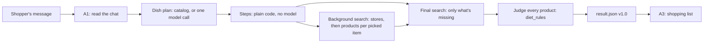

# Guided dish building: design

Date: 2026-11-27. Status: approved and built (2026-11-27); see section 12 for what changed while building. Builds on `feature/postgres-accounts`
(chats in memory, accounts in Postgres). Approach 1 of 3 (chosen 2026-11-27).

## 1. Why

Today the chat reads one message, shows a confirm card and searches whatever ingredients
the catalog or the model (A2) picks. That fails in two ways:

- **A vague dish dead-ends.** "Sandwich" is a kind of food, not one recipe, so A2 refuses
  (`keep: false`, no ingredients) and the shopper gets "I couldn't work out the
  ingredients", with a "Try again" that repeats the same answer (temperature 0, cached).
- **The shopper never chooses.** A2 put garlic and onion in a grilled cheese; nobody asked.

The shopper wants the chat to show what people usually put in the dish and let them
choose, step by step (bread, then vegetables, then sauces), while the store search runs
in the background, so the results are ready soon after the last choice. Anything they add
that the steps didn't offer ("pineapple", "Dave's Killer Bread") is searched at the end
and merged into one final list. `docs/project-plan.md` already promises the background
part: "Background search starts as soon as the user starts chatting".

## 2. Decisions (from the brainstorm)

| # | Question | Decision |
|---|---|---|
| Q1 | Which dishes get steps | Every dish, with a **"Use the usual"** skip that goes straight to the search |
| Q2 | How deep | **Ingredients** only. The shopper can add any ingredient or a **named product**; those are searched at the end and merged into the one final list |
| Q3 | An addition clashes with saved allergies or diet | **Warn, offer a safe swap, let them decide** ("search anyway" shows the products as not safe, with the reason). Saved preferences never change |
| Q4 | Dishes outside the catalog | **One wait at the start** (one model call makes the whole plan), then every step is instant |
| Approach | | **1**: the server runs the steps from a dish plan; the model is called at most once per dish |

## 3. What the shopper sees

```
You:        sandwich
Assistant:  Working out what usually goes in a sandwich…            (15–20 s, non-catalog)
Assistant:  [Plan card] Here's how people usually make a sandwich:
            bread · cheese · vegetables · sauces.
            [Choose step by step]   [Use the usual]
Assistant:  [Step 1 of 4: Bread]  ☑ white  ☐ whole wheat  ☐ sourdough  ☐ rye
            Add your own: [________]                        [Back] [Next]
            ... cheese, vegetables, sauces ...
You:        add pineapple                (typed in the chat box during the steps)
Assistant:  Added pineapple to your sandwich.
Assistant:  [Summary card] Sandwich near 45202, vegetarian, without peanuts, for 2
            white bread · cheddar · lettuce · tomato · mayonnaise · pineapple
            [Edit] [Search]
Assistant:  [Search card] stages, then the results page as today (products per
            ingredient with safe / not safe / couldn't verify, then the shopping list)
```

- Usual options are ticked already; each option says how common it is when we know
  ("in 72% of recipes", catalog dishes only).
- Options that clash with saved allergies or diet aren't offered; the step says what was
  left out and why ("Bacon left out: you're vegetarian").
- "Use the usual" (on the plan card, and on every step as "use the usual for the rest")
  searches the dish's usual ingredients: exactly today's search.
- A clashing addition gets a warning card: "Peanut butter contains peanuts, which you
  avoid. Try sunflower seed butter instead?" [Use the swap] [Search peanut butter anyway].
- ZIP, servings, diet and allergens work as today (asked for when missing; saved
  allergens locked, applied again by the server).

## 4. Architecture



New units, each with one job:

| Unit | Where | Does | Depends on |
|---|---|---|---|
| `plans.py` | `backend/app/` | Builds a **dish plan**: steps (label, options, which are usual) from a catalog profile or from the plan model's reply; filters options that clash with the shopper's preferences | catalog, `variants.yaml`, `screen.py` |
| `screen.py` | `backend/app/` | Checks an ingredient or product *name* against avoid + diet with the existing rules, and finds a swap | `diet_rules.detect_allergens` / `classify_diet` on a name-only `ProductEvidence`; `ml/configs/substitutes.yaml` |
| `guided.py` | `backend/app/` | The step state of one chat: current step, picks, additions; turns typed text into additions; produces the final ingredient list | `plans.py`, `screen.py` |
| `prefetch.py` | `backend/app/` | The background search of one chat: stores once the ZIP is known, then products per term; in memory only | the pipeline's store stages (below) |
| `variants.yaml` | `backend/config/` | Hand-written kinds of generic ingredients (sandwich bread → white, whole wheat, sourdough, rye), so catalog dishes get real choices without a model call | none |
| plan prompt | `ml/prompts/plan_dish.txt` + `ml/configs/plan_dish.yaml` | The one model call for a dish outside the catalog, vague dishes included: returns steps with options and which are usual, as JSON with a schema | champion's client (`pantrypath_ml.runtime`) |

Changed units:

- **Data pipeline (`request.py`)**: `build_result` is split into stages it already has
  internally, with no change in behaviour: `find_stores`, `search_terms(terms, stores)`
  (the existing `search_plans` + `merge`) and `assemble_result(ingredients, found, stores,
  request)` (OFF evidence + `judge` + `Result`). `build_result` calls them in order, so
  today's search is unchanged; the backend calls them separately for prefetch and the
  final search.
- **`chat.py`**: new message kinds `plan`, `step`, `clash` and `summary` (the summary
  replaces the confirm card for guided builds). A typed message during a build is read as
  additions, not as a new request (section 6).
- **Engines (`base.py`, `live.py`, `demo.py`)**: `plan(request)`, `prefetch(...)` and
  `search_ingredients(request, ingredients, cache)` alongside today's `parse` and
  `search`. Demo mode implements them with the catalog and its synthetic stores, so the
  whole flow runs and is tested without a model or keys.
- **Frontend**: `PlanCard`, `StepCard`, `ClashCard`, `SummaryCard` components; the chat
  input adds to the current build while one is open. No new dependencies.

**Unchanged:** the `result.json` contract (v1.0), `diet_rules`, A1 and A3, the stronger
model's behaviour on a "Use the usual" search, Postgres (chats and store data are never
saved).

## 5. The dish plan

```
DishPlan
  dish: "sandwich"            source: catalog | model
  steps: [Step]               at most 6; small groups merge into "Pantry basics"
Step
  id, label: "Bread"
  options: [Option]           at most 8 per step
  left_out: [{name, reason}]  clashes with saved preferences
Option
  name: "sourdough bread"     (also the search term)
  usual: bool                 ticked to begin with
  share: 0.72 | null          "in 72% of recipes"; catalog only
```

**From the catalog (instant).** The catalog's 100 dishes have 5 to 22 ingredients each,
with a role (`core`, `common`), a category (`bakery`, `dairy`, `produce`, `condiment`,
`meat`, …) and a share. Categories map to steps (bakery + grain → "Bread and grains";
meat + seafood + egg + legume → "Protein"; produce → "Vegetables and fruit"; dairy →
"Cheese and dairy"; condiment → "Sauces"; spice_herb + baking + oil_fat + sweetener +
nut_seed + beverage + other → "Pantry basics"). `core` ingredients are usual; `common` ones are usual when their
share is at least 0.5. An ingredient listed in `variants.yaml` becomes its kinds; the kind
marked `default` there is ticked when the catalog ingredient is usual (sandwich bread →
white bread ticked, whole wheat, sourdough and rye not).

**From the model (one call, non-catalog dishes).** The plan prompt gets the dish name and
returns the same shape. A vague dish ("sandwich", "pasta", "salad") is allowed and gets a
build-your-own plan. The reply is validated against the schema; options are trimmed to
the limits above. Replies are cached per setting like A1 and A2 (dish name only, no store
data). If the reply is invalid after the client's retries, the chat says so and offers
"Use the usual", which runs today's A2 path.

While the plan call runs (15–20 s locally), the stores near the ZIP are already being
found (section 7).

## 6. Steps, additions and clashes

- **One step card at a time**, in plan order. Next, Back and "Use the usual for the rest".
  Only the newest card can be changed (as with confirm cards today).
- **Additions** come from a step's "Add your own" box or from text typed in the chat while
  a build is open. Typed text is split on commas and "and", and filler words ("add",
  "also", "some", "with") are dropped: "add pineapple and Dave's Killer Bread" → two
  additions. Each is a search term as written, so a product name is searched by name.
  "Remove X" or "no X" unticks or drops X. Switching dish means "Start over" (on every
  card) or a new chat; typed text during a build is never read as a new dish.
- **Clashes**: every addition goes through `screen.py` (the rules, not the model). A
  clash shows a clash card with the swap from `substitutes.yaml` when there is one:
  [Use the swap] [Search it anyway]. "Anyway" keeps the item; its products are judged as
  usual and show as not safe with the reason. Saved preferences never change.
- **Summary card**: the request line and the chosen ingredients, editable like today's
  confirm card. The server applies saved allergens and diet again, whatever it sends.

## 7. Background search

Per chat, in memory (`prefetch.py`), never saved, never logged, ended with the chat (20
idle minutes, logout, delete, restart) and never kept past `PANTRYPATH_RESULT_TTL_MIN`.

1. **Stores**: as soon as the request has a ZIP (often during the plan call).
2. **Usual options**: once the plan exists, products for every usual option at those
   stores.
3. **Each pick**: when an option is ticked or an item added, its products, unless
   already fetched. Unticking keeps what was fetched (it may be ticked again).
4. **Final search**: the summary's ingredients minus what is already fetched or still
   running (it waits for those), then judging, `result.json`, A3.

Store calls stay close to today's: about one call per ingredient per store (today about
38 per search; Kroger's daily limit is reportedly about 10,000, not yet verified). Picks add calls only for what is
actually ticked. A failed prefetch is retried once in the final search; a provider that
fails then is reported as today.

## 8. Errors

| Case | What the shopper sees |
|---|---|
| Plan model call fails or is invalid | "I couldn't plan the choices for X" + [Use the usual] (today's path) |
| Dish not found by "Use the usual" either | Today's message, without a "Try again" button (nothing would change) |
| No store near the ZIP | Today's "no store" card, shown as soon as the store lookup finds none, before the steps |
| Background search fails | Nothing during the steps; the final search fetches again |
| Chat ends during a build | "This chat has ended" (as now) |

## 9. Testing

TDD, the backend suite (Postgres in Docker) and demo mode, no model or keys needed:

- `plans.py`: catalog grouping, usual flags, variants, step and option limits, filtering
  by allergens and diet (e.g. no bacon for a vegetarian, no peanut sauce for a peanut
  avoider), model replies (valid, invalid, oversized).
- `screen.py`: name checks for every allergen and diet the rules know; swaps; no swap.
- `guided.py`: step order, Back, skip, "use the usual for the rest", typed additions and
  removals, only the newest card can change, start over.
- `prefetch.py`, with a counting fake provider: stores once, usual options once, picks
  once, nothing fetched twice, final search fetches only what's missing, failures retried
  once.
- Pipeline split: `build_result` gives the same result as before on the existing tests.
- API (demo engine): the whole flow, "Use the usual" equals today's search, clashes,
  additions merged into one result, saved allergens re-applied, no store or product name
  and no chat text in the database.
- Live, by hand (Ollama + Kroger): "sandwich" → steps → pineapple added → one list.
- Plan prompt: a small dev set (10 dishes, vague and specific) checked by schema and by
  hand; full evaluation through `ml/`'s pipeline is a follow-up for the ML owner.

## 10. Out of scope (this version)

Choosing products (Q2 option B), quantities per step (Q2 option C), remembering choices
in the profile (the later "distill preferences" work), the stronger model for guided
builds (stays on "Use the usual" searches), a promoted, evaluated plan prompt in the ML
registry.

## 11. Owners and order

The data pipeline split and the plan prompt are in teammates' areas (`data-pipeline/`,
`ml/`); they should review those parts. Suggested build order, each step tested before
the next: pipeline split → `screen.py` → `plans.py` (catalog) → `guided.py` + chat cards
(demo mode) → `prefetch.py` → frontend cards → plan prompt + live engine → live test.
Work on a new branch from `main` once `feature/postgres-accounts` is committed.

## 12. Changes made while building (2026-11-27)

- **Templates before the model.** Kinds of food (sandwich, salad, pasta, wrap, bowl) get a
  hand-written plan (`backend/config/dish_templates.yaml`): instant, the same every time,
  and no model call. The model plans only specific dishes outside the catalog.
- **One build card, not separate plan and step cards.** The card shows the current step
  and is updated in place; the summary at the end is the existing confirm card with the
  chosen ingredients. Fewer messages, and the confirm card's editing and checks are reused.
- **Background search uses the store providers' own cache.** Kroger and Target already
  keep store and product lookups in memory for 15 minutes, so `prefetch` runs the same
  searches early (Kroger only; Target costs credits) and the final search reads them from
  that cache. No separate per-chat cache was needed. The final search waits for prefetches
  still running.
- **Swaps are offered in place of left-out options**, ticked when the original was usual
  ("smoked tofu" for ham, "roasted chickpeas" for peanuts), after the step's own options.
- **The plan call is part of the message reply** (the chat shows "a dish we don't know can
  take 20 seconds to plan"); store lookups start before it.
- **A setting, `PANTRYPATH_GUIDED`** (default true), turns guided builds off; the confirm
  card flow is also the fallback when no plan can be made.
- **The demo's keyword reader recognises the template dishes**, so the whole flow runs in
  demo mode.
- **The plan prompt was rewritten once** after a live try: the first version's example
  steps ("base or bread", "cheese") made the 4B model put bread and cheddar in dal dhokli.
