# Bias report

## A1: slices

180 cases. Groups under 10 items are shown but not counted in the gap.

| Metric | Largest gap | Slice | Between |
|---|---|---|---|
| allergens_captured | 0.0% | style | casual vs typo |
| allergen_exact | 22.2% | style | synonym vs typo |
| allergen_model_recall | 5.6% | allergen | fish vs wheat |

### allergens_captured by style

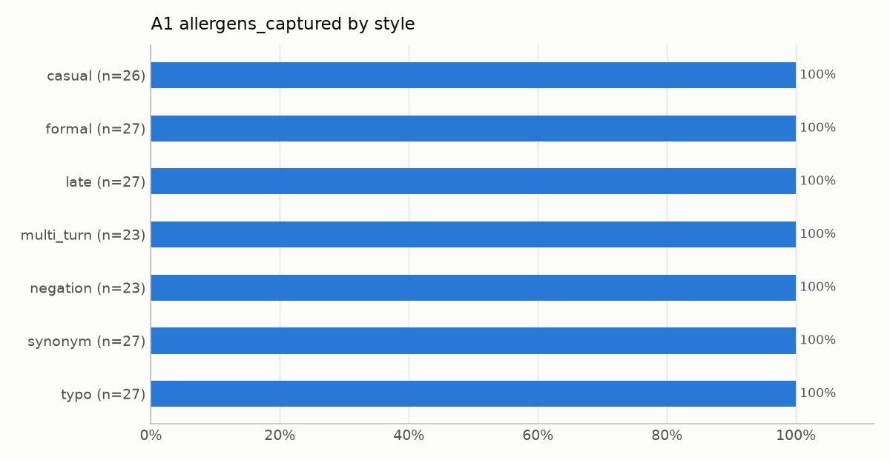

| Group | Value | n |
|---|---|---|
| casual | 100.0% | 26 |
| formal | 100.0% | 27 |
| late | 100.0% | 27 |
| multi_turn | 100.0% | 23 |
| negation | 100.0% | 23 |
| synonym | 100.0% | 27 |
| typo | 100.0% | 27 |

### allergens_captured by diet

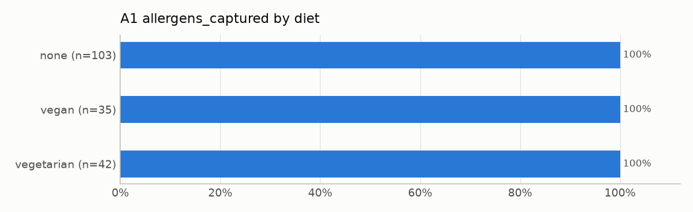

| Group | Value | n |
|---|---|---|
| none | 100.0% | 103 |
| vegan | 100.0% | 35 |
| vegetarian | 100.0% | 42 |

### allergens_captured by allergen

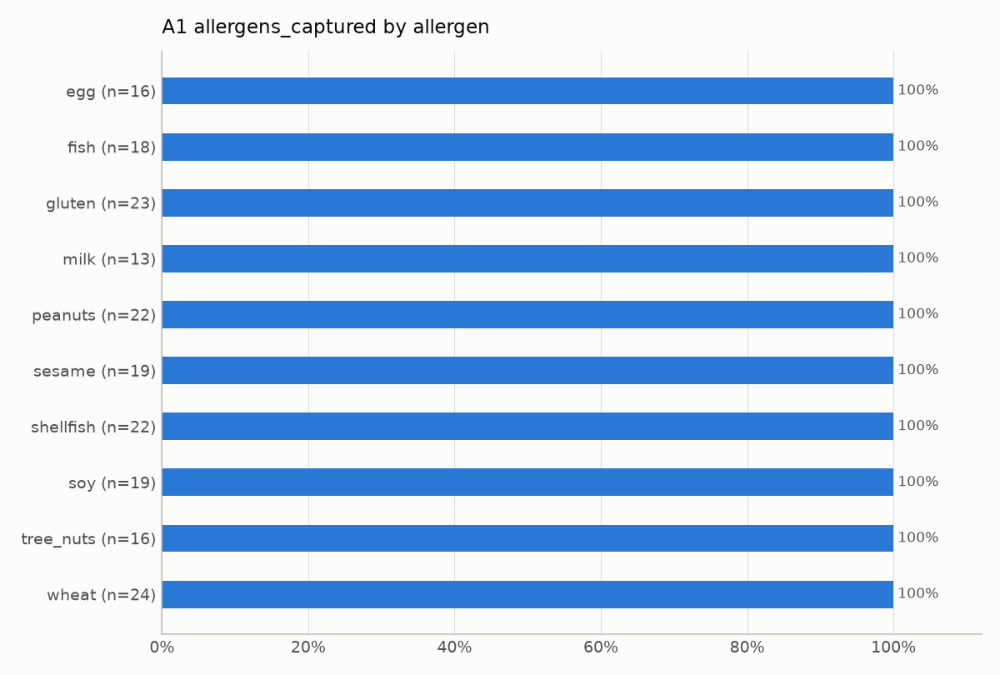

| Group | Value | n |
|---|---|---|
| egg | 100.0% | 16 |
| fish | 100.0% | 18 |
| gluten | 100.0% | 23 |
| milk | 100.0% | 13 |
| peanuts | 100.0% | 22 |
| sesame | 100.0% | 19 |
| shellfish | 100.0% | 22 |
| soy | 100.0% | 19 |
| tree_nuts | 100.0% | 16 |
| wheat | 100.0% | 24 |

### allergen_exact by style

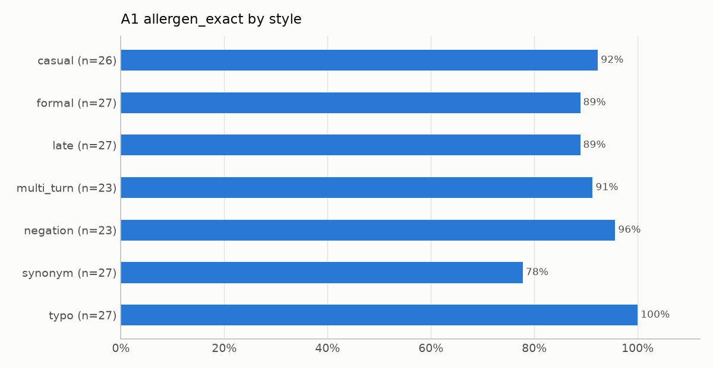

| Group | Value | n |
|---|---|---|
| casual | 92.3% | 26 |
| formal | 88.9% | 27 |
| late | 88.9% | 27 |
| multi_turn | 91.3% | 23 |
| negation | 95.7% | 23 |
| synonym | 77.8% | 27 |
| typo | 100.0% | 27 |

### allergen_exact by diet

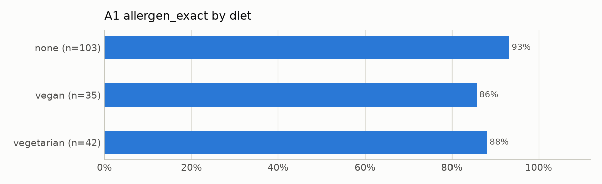

| Group | Value | n |
|---|---|---|
| none | 93.2% | 103 |
| vegan | 85.7% | 35 |
| vegetarian | 88.1% | 42 |

### allergen_model_recall by allergen

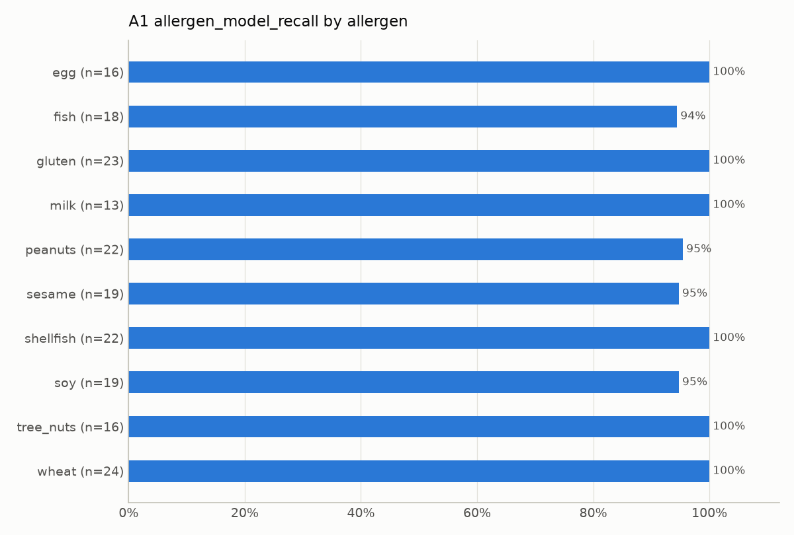

| Group | Value | n |
|---|---|---|
| egg | 100.0% | 16 |
| fish | 94.4% | 18 |
| gluten | 100.0% | 23 |
| milk | 100.0% | 13 |
| peanuts | 95.5% | 22 |
| sesame | 94.7% | 19 |
| shellfish | 100.0% | 22 |
| soy | 94.7% | 19 |
| tree_nuts | 100.0% | 16 |
| wheat | 100.0% | 24 |

## A2: slices

100 cases. Groups under 10 items are shown but not counted in the gap.

| Metric | Largest gap | Slice | Between |
|---|---|---|---|
| recall | 13.5% | cuisine | european vs east_se_asian |
| core_precision | 12.8% | cuisine | latin_american vs european |
| valid_profile_rate | 0.0% | popularity | high vs mid |

### recall by cuisine

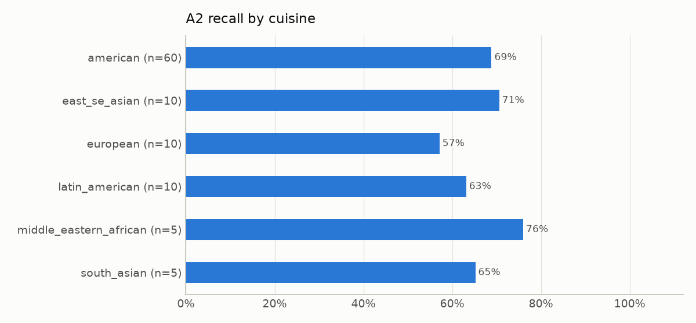

| Group | Value | n |
|---|---|---|
| american | 68.9% | 60 |
| east_se_asian | 70.6% | 10 |
| european | 57.1% | 10 |
| latin_american | 63.2% | 10 |
| middle_eastern_african | 76.0% | 5 |
| south_asian | 65.2% | 5 |

### recall by popularity

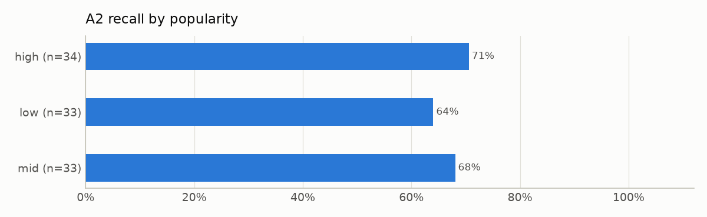

| Group | Value | n |
|---|---|---|
| high | 70.6% | 34 |
| low | 64.0% | 33 |
| mid | 68.1% | 33 |

### core_precision by cuisine

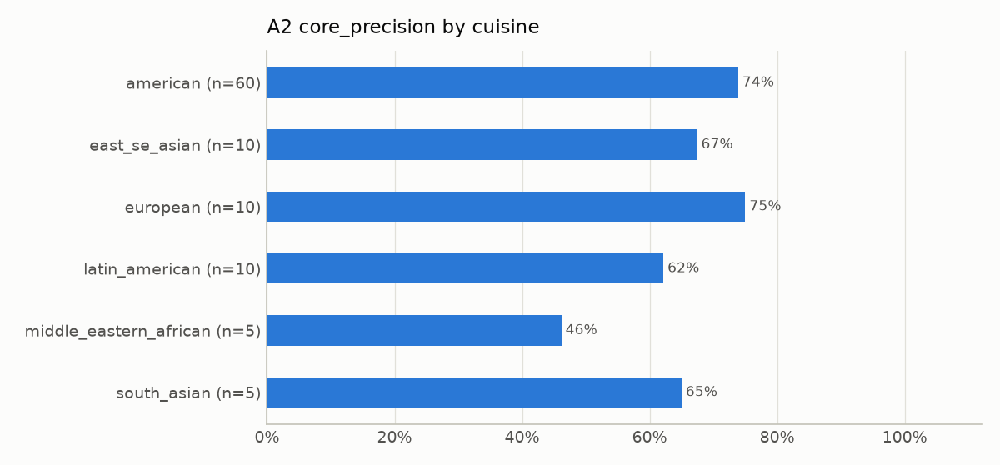

| Group | Value | n |
|---|---|---|
| american | 73.9% | 60 |
| east_se_asian | 67.4% | 10 |
| european | 75.0% | 10 |
| latin_american | 62.2% | 10 |
| middle_eastern_african | 46.2% | 5 |
| south_asian | 65.0% | 5 |

### core_precision by popularity

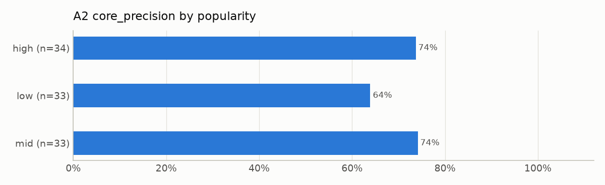

| Group | Value | n |
|---|---|---|
| high | 73.7% | 34 |
| low | 63.9% | 33 |
| mid | 74.1% | 33 |

### valid_profile_rate by cuisine

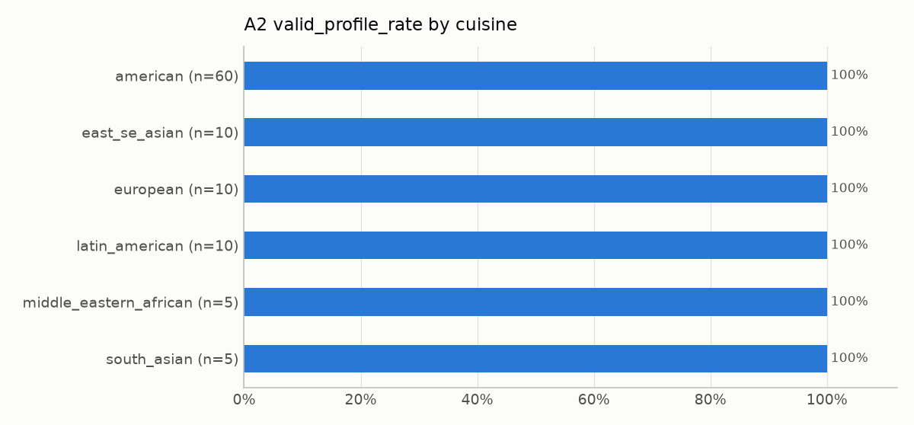

| Group | Value | n |
|---|---|---|
| american | 100.0% | 60 |
| east_se_asian | 100.0% | 10 |
| european | 100.0% | 10 |
| latin_american | 100.0% | 10 |
| middle_eastern_african | 100.0% | 5 |
| south_asian | 100.0% | 5 |

### valid_profile_rate by popularity

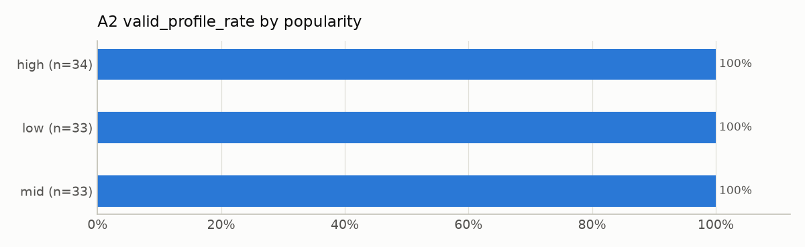

| Group | Value | n |
|---|---|---|
| high | 100.0% | 34 |
| low | 100.0% | 33 |
| mid | 100.0% | 33 |

